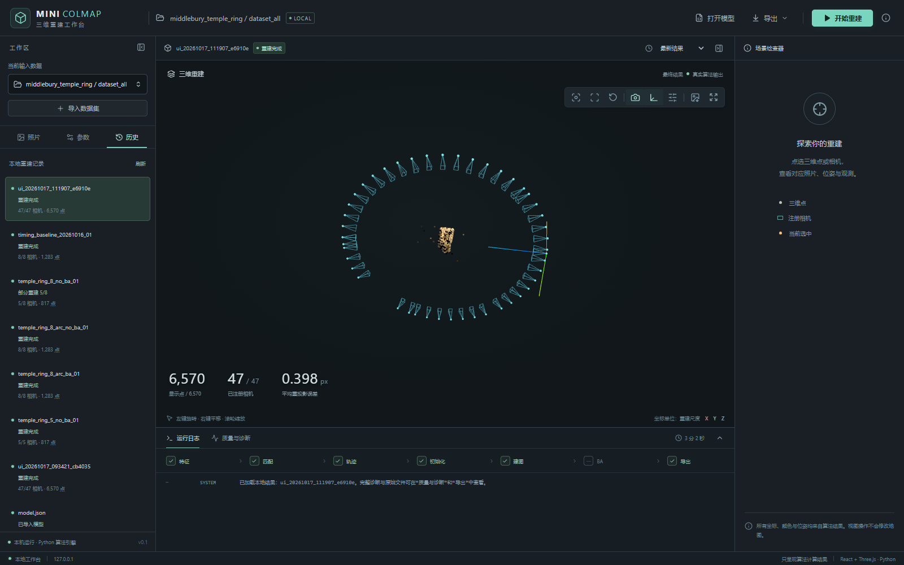
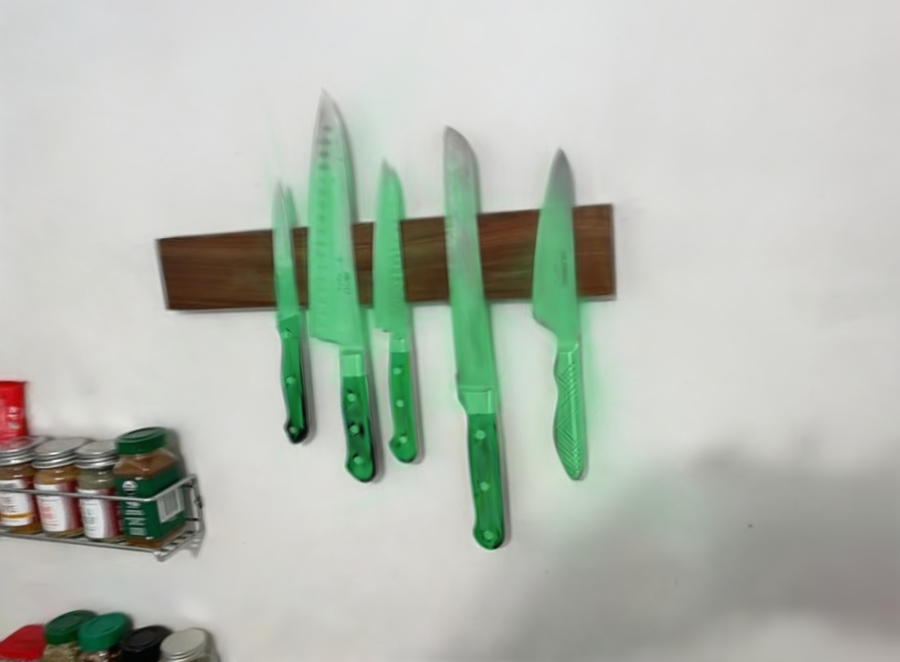
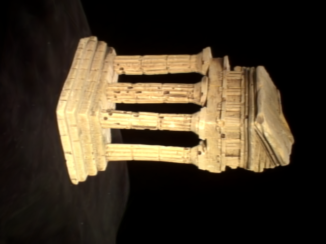

# Mini-COLMAP

**从多视图照片到稀疏重建、新视图合成与三维文本检索的本地工作台。**

Python 实现增量 SfM、NeRF 与 3D Gaussian Splatting 的核心流程，React + Three.js 提供交互检查，FastAPI 管理计算任务，CUDA/gsplat 支持实时高斯渲染。



*TempleRing 实际重建：47/47 台相机注册，6,570 个三维点；照片、相机、轨迹与重投影误差联动检查。*

## 功能

- **增量 SfM**：SIFT 匹配、自适应 F-RANSAC、E 分解、三角化、冲突轨迹处理、PnP 注册与可选 Bundle Adjustment；候选排序和上界剪枝加速初始化。
- **新视图合成**：NeRF 射线采样与体渲染；3DGS 各向异性协方差、0–3 阶球谐颜色、Alpha 合成、增密/剪枝与 CUDA 后端。
- **训练优化**：拓扑变化时迁移 Adam 状态、分组学习率与位置衰减、可见性累计的屏幕梯度密度控制、L1＋SSIM 损失。
- **三维文本检索**：SAM/OpenCLIP 特征、压缩与冻结 RGB 的语言场训练；文本视角搜索、三维高亮、隔离、恢复和选区 ZIP 导出。支持从自己的 3DGS 任务生成独立语义索引。
- **交互工作台**：点云/相机检查、独立计算进程、SSE 进度、取消与历史记录、显卡选择、带依赖检查的任务清理，以及 WebSocket 实时图像流。
- **数据适配**：标定照片清单、Middlebury 准备、LERF-OVS 已知位姿与稀疏模型导入，JSON/PLY/COLMAP TXT 导出。



*Waldo Kitchen 的高斯选区渲染；运行此示例需另行准备照片、模型和语义索引。*

## 快速开始

建议 **Python 3.12**。基础 SfM 与工作台可在 CPU 运行；训练需额外安装 PyTorch；实时 3DGS 和语义流程需要 NVIDIA CUDA 环境。以下命令在项目根目录执行：

```powershell
# Windows PowerShell
python -m venv .venv
.\.venv\Scripts\python.exe -m pip install -e ".[ui]"
.\.venv\Scripts\python.exe scripts/prepare_middlebury.py
.\.venv\Scripts\python.exe -m minicolmap ui
```

浏览器打开 **http://127.0.0.1:8765/**；“重建与训练”进入 `/#workspace`。数据准备脚本会下载公开照片，已有非空目录时拒绝覆盖。预训练演示场景需另行准备，首次使用可先运行 SfM：

```powershell
.\.venv\Scripts\python.exe -m minicolmap run --dataset data/middlebury_temple_ring/dataset.json --output outputs/temple_demo --config configs/temple_ring_no_ba.json
.\.venv\Scripts\python.exe -m minicolmap inspect outputs/temple_demo/model.json
```

每次运行使用新的输出目录。前端生产资源随 Python 包提供，日常使用无需 Node 或在线 CDN。Linux/GPU 安装、SSH 隧道、训练和语义资源准备见 [使用指南](docs/usage.md)、[Linux 部署](docs/linux-deployment.md) 与 [语义检索](docs/semantics.md)。

## 实验结果

以下汇总已保存的场景实验。数据划分、逐项结果与测量条件见 [实验说明](docs/evaluation.md)，紧凑指标与来源指纹见 [实验记录](reports/README.md)。

| 项目 | 结果 | 条件 |
| --- | --- | --- |
| TempleRing SfM | **47/47 相机，6,570 点，0.398 px** 平均误差 | 640×480，最终全局 BA 关闭 |
| 初始化剪枝 | **31.761 s → 1.097 s，约 29×** | 同配置历史单次对照 |
| NeRF / 3DGS | **24.17 / 31.83 dB PSNR** | TempleRing，36 训练 / 11 验证，160×120，分别 6,000 / 5,000 步 |
| 3DGS 训练策略 | **26.45 → 36.02 dB；SSIM 0.7870 → 0.9546** | Temple312，同地图、640×480、10,000 步；297 训练 / 8 dev / 7 test，单种子 |
| 三维语言场 | Dev **mIoU 35.87% → 42.99%** | Waldo Kitchen，冻结同一 RGB，173 个语言训练视图、11 个 Dev 查询，上游式后处理协议 |
| 百万高斯实时链路 | GPU **9.65 → 3.91 ms**；客户端接收解码 **45.66 → 59.11 帧/s** | RTX A6000，100 万高斯，1280×720，JPEG95，预热 3 s、测量 15 s |

| Temple312 测试视角原图 | 优化后的 3DGS |
| :---: | :---: |
|  |  |

*36.02 dB 为 7 个固定 test 视角按平均 MSE 计算的汇总 PSNR。组合策略的画质收益伴随实际高斯数和训练耗时增加，各项改动的作用见消融实验。*

## 代码结构

| 路径 | 职责 |
| --- | --- |
| [src/minicolmap/](src/minicolmap/) | 几何估计、轨迹、增量地图、BA 与导出 |
| [rendering/](src/minicolmap/rendering/) | NeRF/3DGS 数学、训练策略与实时渲染 |
| [semantics/](src/minicolmap/semantics/) | 特征编码、语言场、文本定位与三维选区 |
| [ui/](src/minicolmap/ui/) / [web/](web/) | FastAPI 任务服务与 React + TypeScript + Three.js 界面 |
| [configs/](configs/) / [scripts/](scripts/) | 配置、数据准备、环境安装与可复现实验工具 |
| [tests/](tests/) / [exercises/](exercises/) | 数值、退化情况、训练策略与接口回归测试 |

SIFT/PnP 使用 OpenCV，非线性求解使用 SciPy，自动微分使用 PyTorch，CUDA 光栅使用 gsplat；语义流程复用 SAM、OpenCLIP 和固定版本的 LangSplat 参考组件。实现与第三方职责见 [架构说明](docs/architecture.md) 和 [第三方来源](THIRD_PARTY_NOTICES.md)。

## 开发与测试

```powershell
.\.venv\Scripts\python.exe -m pip install -e ".[dev,ui,ui-test,render]"
# CPU 回归：隐藏 GPU；CUDA 专项另在显式选定的空闲设备上执行
$env:CUDA_VISIBLE_DEVICES = ""
$env:MINICOLMAP_TEST_GSPLAT = "0"
.\.venv\Scripts\python.exe -m pytest tests exercises -q -p no:cacheprovider --ignore=tests/support/test_gaussian_cuda.py --ignore=tests/support/test_nerf_cuda.py --ignore=tests/support/test_gsplat_native.py

cd web
npm ci
npm test
npm run build
```

前端构建更新 Python 包内的静态资源。浏览器端到端检查需要运行中的工作台和对应数据；CPU 回归与浏览器检查的执行方法见 [验证方法](docs/evaluation.md#验证方法)。

## 文档与范围

- [安装与使用](docs/usage.md) · [Linux 部署](docs/linux-deployment.md)
- [架构与数学约定](docs/architecture.md) · [参数与数据格式](docs/configuration.md)
- [实验与评测](docs/evaluation.md) · [3DGS 优化与消融](docs/3dgs-optimization-ablation.md)
- [LERF 数据准备](docs/lerf-data-guide.md) · [语义检索](docs/semantics.md) · [新场景流程](docs/new-scene-workflow.md)

项目面向小型静态场景。现有多视角检查中，水槽和刀具通过，杯子的跨视角表现仍不稳定。未知内参自动标定、稠密 MVS、网格重建和联合位姿训练尚未实现。公开仓库提供源码、测试、截图和紧凑指标；照片、基础模型权重、训练检查点和原始特征数组需另行准备，并遵守相应数据与依赖的使用条件。
