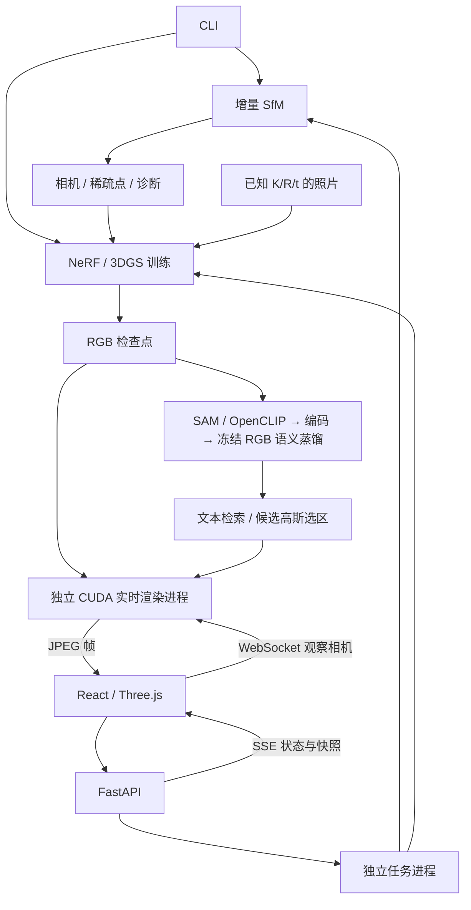

# 架构与实现

Mini-COLMAP 将增量 SfM、固定位姿的新视图训练和三维语义检索连接起来。CLI 与工作台复用 Python 流水线；浏览器负责参数输入、结果检查和观察相机，后端进程执行位姿估计与模型训练。

## 数据流与模块

已知位姿可直接训练 NeRF；**当前 3DGS 需要相机清单与有效稀疏点云**。语义流程以上游已完成的 3DGS 作为输入。

| 模块 | 职责 |
| --- | --- |
| [geometry](../src/minicolmap/geometry.py)、[tracks](../src/minicolmap/tracks.py)、[mapper](../src/minicolmap/mapper.py) | 几何验证、轨迹冲突处理、初始化、增量注册与三角化 |
| [optimization](../src/minicolmap/optimization.py)、[ba](../src/minicolmap/ba.py) | 两视图精化、BA 残差与候选检查 |
| [SfM pipeline](../src/minicolmap/pipeline.py) | SIFT/匹配、建图调度、诊断、计时与快照 |
| [rendering](../src/minicolmap/rendering/) | NeRF/3DGS 数学、数据归一化、优化、检查点、reference/gsplat 后端 |
| [semantics](../src/minicolmap/semantics/) | SAM/OpenCLIP 适配、特征压缩、语言场、文本查询与选区验证 |
| [ui](../src/minicolmap/ui/) | 资源发现、历史索引、子进程任务、GPU 预留与实时会话 |
| [web](../web/src/) | 参数面板、地图检查、训练预览、场景演示与自由视角浏览 |

## 增量 SfM

1. 校验照片、已知内参和路径，提取 OpenCV SIFT 特征。
2. 穷举图像对，执行双向 ratio 匹配与 F-RANSAC；根据当前内点率缩短采样预算，同时保留最小迭代数和硬上限。
3. 从验证后的匹配构建轨迹，处理同一轨迹包含同图多个特征的冲突。
4. 对初始化候选执行 E 分解、正深度/视差检查、三角化和两视图精化，按有效唯一轨迹点数等条件选取初始地图。
5. 用 PnP-RANSAC 注册新图像，补充观测并三角化新轨迹。
6. 按配置执行最终全局 BA，检查候选后写回并导出诊断。

图像对准入 `geometry.min_pair_inliers` 与初始化 `geometry.min_inliers` 分开设置。轨迹默认整组丢弃冲突；`mapping.track_conflict_policy=split` 按三视图共同支持优先合并，并拒绝产生同图特征冲突的连接。位姿由图像匹配估计，两种策略沿用相同的 PnP、视差和重投影要求。

初始化按候选匹配数上界排序，仅当上界**严格小于**当前合格最佳候选的有效点数时跳过精化；相等时继续计算以保留次级裁决。剪枝作用于初始化求解阶段，此前的匹配与 F-RANSAC 沿用原流程。

运行记录匹配图；不连通输入可能部分注册，当前只构建单一地图，不自动合并多个分量。BA 的“候选被接受”和“求解器收敛”分别记录：达到求解预算但仍有效、误差改善的候选可以被接受。

## NeRF 与 3DGS

**NeRF** 使用位置编码、带跳连和视角颜色分支的单个 MLP、沿射线的分段随机采样与体渲染，支持单图或跨照片采样、固定验证集和分块渲染。当前采用固定位姿训练，coarse/fine 两级网络与层次重要性采样尚未实现。near/far 使用归一化场景距离，应按当前场景设置。

**3DGS** 保存中心、对数尺度、wxyz 四元数、不透明度 logit 和实球谐系数。稀疏点 RGB 初始化 SH 的 DC 项；旋转与尺度构成三维协方差，经投影 Jacobian 得到屏幕椭圆并按深度合成。

- PyTorch reference 后端用于小规模数学、梯度和结果检查；gsplat 提供 CUDA 光栅，项目实现协方差与方向颜色计算。
- 支持 SH degree 0–3、拓扑变化时迁移 Adam 状态、分组学习率、位置衰减、自适应密度控制及 L1＋SSIM；保留历史 `legacy` 策略作对照，见 [3DGS 优化与消融](3dgs-optimization-ablation.md)。
- `max_gaussians` 设定初始化与增长的容量上限，实际高斯数由初始化和密度控制决定。默认增密关闭，设置 `densify_every>0` 可启用。
- SH 方向为世界坐标中 `normalize(mean-C)`，即相机中心指向高斯；采用 Graphdeco 实球谐顺序，颜色为 `max(0, 0.5 + Σ(coeff·basis))`。degree 3 每个高斯有 48 个颜色系数。

## 三维语义检索

SAM 产生区域，OpenCLIP 提供 512 维区域/文本特征；编码器将区域特征压缩，语言场只优化每高斯特征，冻结 RGB、几何、不透明度和高斯顺序。查询将三维特征渲染、解码并与正负文本比较，再生成候选高斯选区。

通用新场景使用单层区域、PCA32 和 3,000 步蒸馏；Waldo Kitchen 的 LangSplat 官方组件参考及 raw3 实验使用各自配套的编码器、检查点和评测协议。新场景候选的语义准确率与跨视角发布验证尚待完成。选区表示可见高斯表面。方法差异、资源准备和 CLI 见 [语义流程](semantics.md)。

## 坐标、像素与尺度

| 项目 | 约定 |
| --- | --- |
| 位姿 | `X_camera = R @ X_world + t`；相机中心 `C = -R.T @ t` |
| 相机轴 | `+X` 右、`+Y` 下、`+Z` 前；像素原点在左上 |
| 单目尺度 | SfM 世界单位不解释为米 |
| 训练归一化 | 保存场景中心与尺度；checkpoint 张量处于归一化坐标 |
| 图像缩放 | OpenCV 半像素约定：`K_new=A@K`，`A=[[sx,0,(sx-1)/2],[0,sy,(sy-1)/2],[0,0,1]]` |
| 高斯导出 | 导出中心、尺度和协方差恢复为原 SfM 世界单位 |
| 三维显示 | 根据 K/R/t 构造相机视锥，并转换到 Three.js 观察坐标；显示筛选不改变估计地图 |

[LERF 数据适配器](lerf-data-guide.md) 支持已去畸变的 COLMAP 二进制 SIMPLE_PINHOLE/PINHOLE，并处理像素中心差异；输入须使用该指南规定的相机和模型格式。

## 任务、快照与实时链路

FastAPI 默认只监听 `127.0.0.1`。工作台一次运行一个重建/训练任务，保存启动配置；SSE 传递阶段、计数与快照版本，前端按快照版本读取序列化的地图状态。取消终止任务进程，保留已有诊断与最后有效快照。刷新页面可重新关联任务，不提供训练暂停续跑。

实时 3DGS 会话将模型一次性载入独立 CUDA 进程。浏览器发送观察相机，后端保留一个执行请求和最新待执行请求，避免拖拽积压；CUDA 渲染后读回、JPEG 编码并经 WebSocket 发送，浏览器按帧号及会话代次显示。性能分别记录 GPU 渲染耗时与端到端新图像显示速率。

训练、语义任务与实时会话共享项目内 GPU 预留，启动前还需检查主机上的外部任务占用。首次使用请在页头显式选择本机可用的物理卡，代码默认编号为 7。所选卡不存在或不可用时任务报错。输出、历史清理与远程访问见 [使用指南](usage.md) 和 [Linux 部署](linux-deployment.md)。

## 范围与依赖

项目实现几何、表示与训练调度；OpenCV 提供 SIFT/PnP，SciPy 提供非线性求解，PyTorch 提供自动微分/优化器，gsplat 提供 CUDA 光栅，SAM/OpenCLIP 提供预训练视觉语言能力，LangSplat 参考路径使用固定版本的上游组件。

几何输出为稀疏地图，稠密 MVS、网格/表面生成与未知内参自标定尚未实现。模型输入格式见上文及 [LERF 数据指南](lerf-data-guide.md)。部署面向本机单用户服务和 SSH 隧道访问，身份认证、远程任务集群和桌面安装包尚未提供。实验设置和性能测量条件见 [评测说明](evaluation.md)，结果摘要见 [实验记录](../reports/README.md)。
